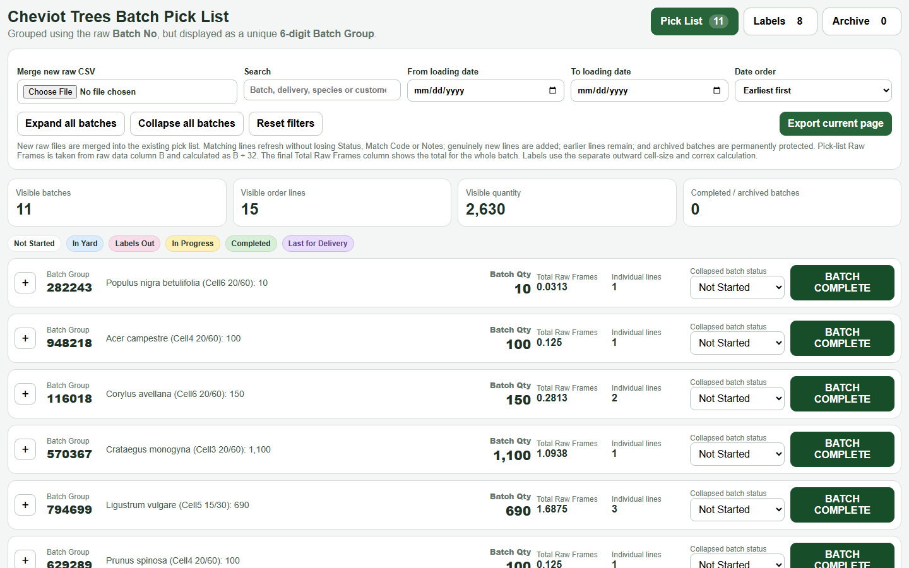
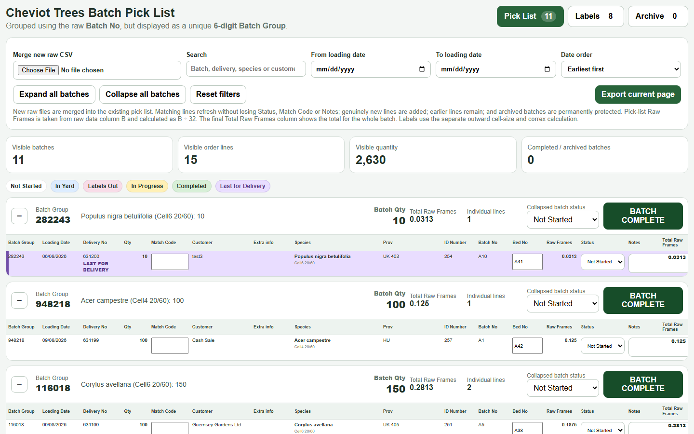
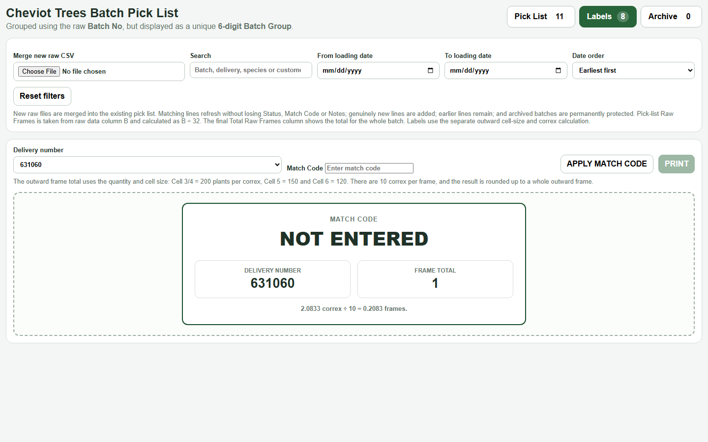
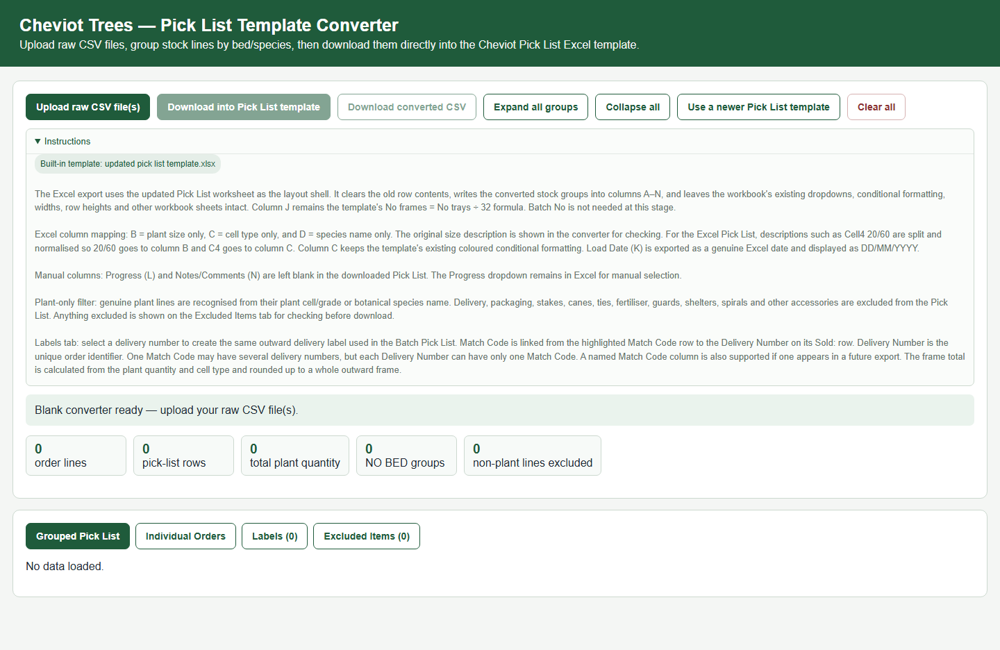
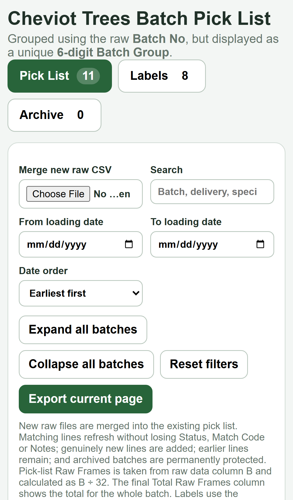

# Cheviot Trees — Pick List Tools

Client project for Cheviot Trees, a UK tree nursery whose grading and picking team handles around
400,000 plants a week in peak season. Orders live in WinTree and are exported as a CSV report that mixes
plant lines with headings, delivery charges, packaging and other non-plant rows. The two browser tools in
this repo turn that export into something the yard can work from: a **Pick List Template Converter** that
reads the raw CSV, keeps only genuine plant requirements, groups them and writes them straight into the
Excel Pick List template, and a **Batch Pick List** mock-up of the next-generation system — one continuous
live pick list grouped by WinTree batch with status tracking, last-for-delivery highlighting, frame
calculations and outward delivery labels. The development brief and the current-process write-up ship in
`docs/`.



## Features

**Batch Pick List mock-up (`batch-pick-list-mockup.html`, v15)**

- One live pick list grouped by the raw WinTree Batch No, displayed as a unique 6-digit Batch Group,
  expandable to the individual delivery lines (loading date, delivery number, quantity, match code,
  customer, species, provenance, ID, batch, bed, raw frames, status, notes).
- Merge new raw CSVs into the existing list: matching lines refresh without losing status, match code or
  notes; genuinely new lines are added; archived batches are protected.
- Line and batch status (Not Started, In Yard, Labels Out, In Progress, Completed) with a Last for
  Delivery flag so the final outstanding line for a delivery number is never missed; Batch Complete moves a
  batch to the Archive tab.
- Filters by loading date range, search by batch / delivery / species / customer, date order, expand and
  collapse all, export of the current page; raw-frame workload calculated as trays ÷ 32.
- Labels tab: outward delivery label per delivery number with match code, delivery number and frame total
  (cell 3/4 = 200 plants per correx, cell 5 = 150, cell 6 = 120; 10 correx per frame, rounded up), apply
  match code and print.
- Ships with sample batches so the mock-up can be explored without data.

**Pick List Template Converter (`pick-list-template-converter.html`, v4 with labels, show working)**

- Upload one or more raw WinTree CSV exports; recognises genuine plant lines from cell/grade or botanical
  species name and excludes delivery, packaging, stakes, canes, ties, fertiliser, guards, shelters and
  other accessories (listed on an Excluded Items tab for checking).
- Splits combined descriptions such as `Cell4 20/60` into size and cell type, extracts bed, species,
  provenance, ID, delivery number, quantity, trays and loading date, and groups stock lines by bed and
  species (the current bed-based combining rule) with NO BED groups kept visible.
- Downloads straight into the Cheviot Pick List Excel template (built-in; a newer template can be
  supplied), preserving the workbook's dropdowns, conditional formatting and formulas, or as a converted
  CSV; Individual Orders view; summary counters for order lines, pick-list rows, plant quantity and
  exclusions.
- Labels tab producing the same 89 × 55 mm outward delivery label, with match codes linked from the
  export to their delivery numbers.

## Screenshots


*Batches expanded to their delivery lines, with the Last for Delivery highlight.*


*Labels tab: outward frame total from quantity and cell size, one label per frame.*


*Pick List Template Converter with its instructions open, ready for a raw CSV.*


*The batch pick list on a phone.*

## Tech stack

- Two standalone HTML files: vanilla JavaScript and CSS; the converter writes `.xlsx` in the browser.
- No server, no installation; open in Chrome or Edge.

## Getting started

```
open batch-pick-list-mockup.html          # explore with the built-in sample batches
open pick-list-template-converter.html    # upload a WinTree CSV export, download the Excel pick list
```

## Project structure

```
batch-pick-list-mockup.html        Batch Pick List mock-up (direction for the new system)
pick-list-template-converter.html  WinTree CSV to Excel Pick List converter with labels
docs/
  Cheviot Trees Pick_List Development Brief Sep2026.docx   full development brief and functional specification
  Cheviot Trees current Pick list process Sept 2026.docx   the current end-to-end workflow
  screenshots/
```

## Documentation

- [Development brief](docs/Cheviot%20Trees%20Pick_List%20Development%20Brief%20Sep2026.docx) — purpose,
  supplied files, batch versus bed grouping, CSV merge and refresh rules, status and archive logic, frame
  calculations, label printing, users and access.
- [Current process](docs/Cheviot%20Trees%20current%20Pick%20list%20process%20Sept%202026.docx) — WinTree
  export, converter, Excel pick list, weekly workflow.

## Status / notes

- The converter screenshot shows the empty state: the client's WinTree exports and the season pick-list
  workbooks are order data and are not included in this repository.
- The mock-up is the agreed direction for a multi-user system (shared data, per-user views, batch primary
  with bed fallback) described in the brief; it is a front-end demonstration, not the production build.
